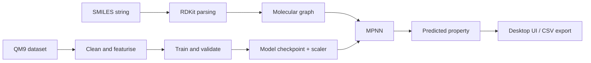

<div align="center">
  

  <p><strong>From molecular structure to learned property predictions.</strong></p>

  <p>
    <a href="https://github.com/BlagojaBudzak/MolGapNet/stargazers"></a>
    <a href="https://github.com/BlagojaBudzak/MolGapNet/network/members"></a>
    
    
  </p>
</div>

---

## 🧬 Overview

**MolGapNet** is a molecular machine-learning project that uses a **Message Passing Neural Network (MPNN)** to estimate molecular properties from SMILES strings. It combines cheminformatics, graph representation learning, and a desktop application into an end-to-end workflow—from molecular input to a prediction you can inspect and export.

The repository includes a QM9 dataset file, a trained model checkpoint, its fitted target scaler, the training pipeline, and a Tkinter desktop interface.

> **Current checkpoint:** configured to predict the **HOMO–LUMO energy gap** (`gap`) in Hartree (`Ha`).

## ✨ Features

- **Graph-based molecular representation** — RDKit parses SMILES and converts molecules into atom-and-bond graphs.
- **Bond-aware message passing** — the MPNN uses atom features and bond features to learn molecular representations.
- **Desktop inference app** — enter SMILES, view a rendered molecular structure, and inspect common molecular descriptors alongside the prediction.
- **Batch predictions** — load a CSV file containing a column with `smiles` in its name.
- **Exportable results** — save prediction history to CSV for further analysis.
- **Training pipeline** — train the model on QM9 or adapt the pipeline to a compatible molecular dataset.
- **Windows packaging workflow** — build a standalone application and installer with PyInstaller and Inno Setup.

## 🧠 How it works



### Molecular graph representation

Each molecule is represented as a graph:

| Component | Representation |
|---|---|
| **Atoms (nodes)** | 28 features describing element, hybridisation, chirality, atomic properties, charge, hydrogen count, ring membership, and aromaticity |
| **Bonds (edges)** | 6 features describing bond type, conjugation, and ring membership |
| **Model** | Edge-conditioned graph convolutions, residual updates, and mean/sum graph pooling |
| **Target scaling** | Standardisation during training, with predictions converted back to the target's original units |

The training blueprint also includes **GCN** and **GAT** regressor implementations for experimentation; the supplied inference application loads the MPNN checkpoint.

## 🖥️ Desktop application

The GUI is designed to make model inference accessible without writing code for every prediction.

- Enter one SMILES string or several newline-separated strings.
- Render the molecular structure.
- View the predicted property and descriptors such as molecular formula, molecular weight, LogP, hydrogen-bond donors/acceptors, ring count, atom count, and bond count.
- Load a CSV for batch prediction.
- Export the prediction history as a CSV file.

## 🚀 Quick start

### 1. Clone the repository

```bash
git clone https://github.com/BlagojaBudzak/MolGapNet.git
cd MolGapNet
```

### 2. Create an environment

Python **3.10 or newer** is recommended.

**Windows (PowerShell):**

```powershell
python -m venv .venv
.venv\Scripts\Activate.ps1
python -m pip install --upgrade pip
```

**Linux / macOS:**

```bash
python3 -m venv .venv
source .venv/bin/activate
python -m pip install --upgrade pip
```

### 3. Install dependencies

Install a PyTorch build compatible with your operating system and hardware. For GPU use, select the appropriate CUDA build from the [official PyTorch installation guide](https://pytorch.org/get-started/locally/).

```bash
python -m pip install torch torchvision
python -m pip install torch-geometric
python -m pip install rdkit pandas numpy scikit-learn tqdm pillow
```

PyTorch and PyTorch Geometric versions need to be compatible. If installation fails, follow the [PyTorch Geometric installation instructions](https://pytorch-geometric.readthedocs.io/en/latest/install/installation.html). On some Linux systems, Tkinter may need to be installed through the system package manager.

### 4. Launch MolGapNet

With the dependencies installed and the included checkpoint and scaler in the repository root:

```bash
python inference_gui.py
```

The application uses the available CUDA device when supported; otherwise it runs on CPU.

## 🧪 Training the model

The repository includes the QM9 CSV and a configurable training blueprint.

```bash
python molecular_gnn_blueprint.py
```

The default configuration trains an MPNN to predict the `gap` target. Training uses RDKit molecular graphs, standardises the target, evaluates validation performance, and saves the best checkpoint and fitted scaler as `best_model.pt` and `scaler.pkl`.

To train for another property available in the dataset, edit the `TARGET` setting near the bottom of `molecular_gnn_blueprint.py` and select a matching target column in `qm9.csv`. **Retraining replaces the checkpoint and scaler in the project root**, so keep a backup if you need the included model.

Training from scratch can be computationally expensive; a compatible GPU is recommended for practical iteration.

## 📄 Batch inference CSV

Use the GUI's batch-prediction option to select a CSV file. It looks for a column whose name contains `smiles` (case-insensitive), then predicts each non-empty entry.

The exported history includes the SMILES, predicted target value, and unit. Review invalid or unsupported structures before using results in downstream analyses.

## 📦 Build a Windows installer

The repository includes a build script for packaging the application.

1. Install [PyInstaller](https://pyinstaller.org/) and [Inno Setup](https://jrsoftware.org/isinfo.php).
2. Make sure the checkpoint, scaler, and source files are present.
3. From the repository root, run:

```bash
python -m pip install pyinstaller
python build.py --target gap --version 1.0.0
```

The script packages the app and, when Inno Setup is installed at the configured path, creates an installer under `dist/`. If Inno Setup is installed elsewhere, update the `INNO_SETUP` path in `build.py`.

## 🗂️ Project structure

```text
MolGapNet/
├── inference_gui.py             # Desktop inference interface
├── molecular_gnn_blueprint.py   # Graph features, models, training, prediction
├── qm9.csv                      # QM9 dataset used by the training pipeline
├── best_model.pt                # Model checkpoint used by the GUI
├── scaler.pkl                   # Fitted target scaler
├── app_config.json              # App configuration (target, paths, dimensions)
├── build.py                     # Windows packaging script
├── MolecularGNN.spec             # PyInstaller specification
├── MolecularGNN.iss              # Inno Setup installer script
└── models/                       # Additional model/app files
```

## 🔬 Scope and limitations

MolGapNet is a **research and learning project** for exploring molecular property prediction. Predictions are estimates learned from the training data, not replacements for quantum-chemical calculations or experimental measurements. For scientific use, evaluate the model on an appropriate held-out dataset and check performance for the chemical space relevant to your application.

The repository does not currently publish a verified benchmark report, so no test-set error or accuracy claim is made here.

## 📚 References

- Gilmer et al., [*Neural Message Passing for Quantum Chemistry*](https://arxiv.org/abs/1704.01212), ICML 2017.
- Ramakrishnan et al., [*Quantum chemistry structures and properties of 134 kilo molecules*](https://doi.org/10.1038/sdata.2014.22), Scientific Data, 2014.
- [RDKit documentation](https://www.rdkit.org/docs/) · [PyTorch documentation](https://pytorch.org/docs/) · [PyTorch Geometric documentation](https://pytorch-geometric.readthedocs.io/)

---

<div align="center">
  <sub>Built by <a href="https://github.com/BlagojaBudzak">Blagoja Budzak</a> · Science → Data → Models → Software</sub>
</div>
